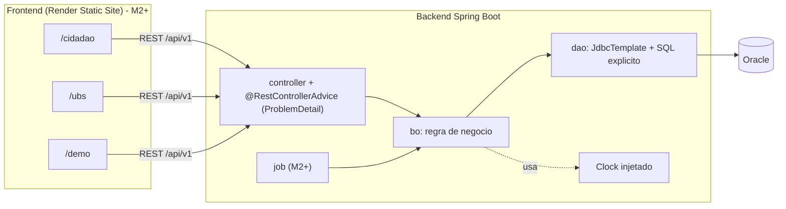
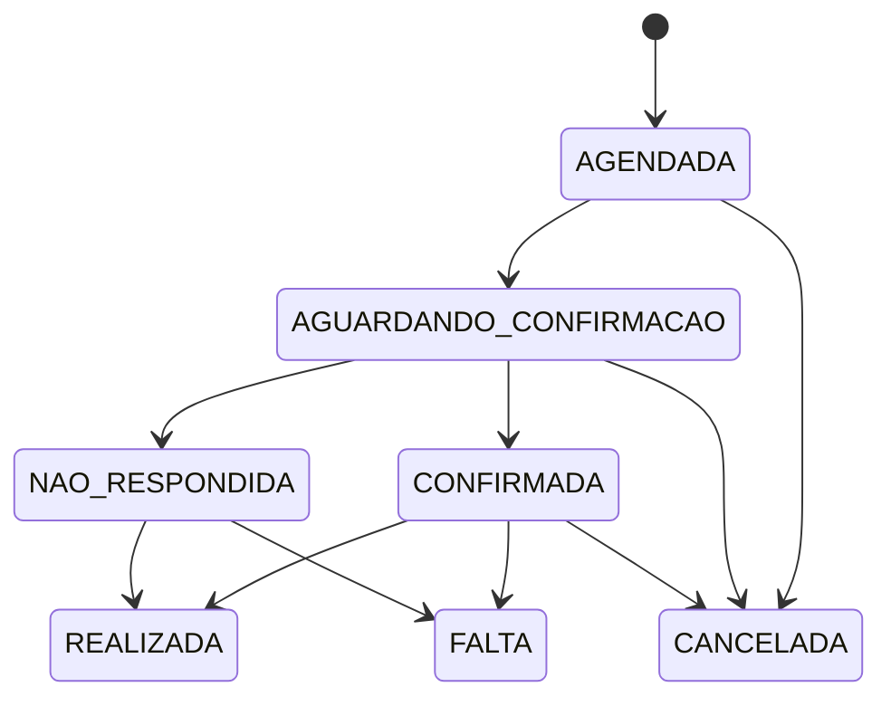

# Arquitetura

## Camadas
- **controller**: recebe, valida (Bean Validation nos DTOs) e delega. Sem regra de negócio.
- **bo**: toda a regra. Mudanças de status passam por `transicionar(...)`, que consulta a máquina de estados do enum (`StatusTransicionavel`) e lança `RegraNegocioException` (HTTP 422) se inválida.
- **dao**: SQL explícito com `NamedParameterJdbcTemplate`; `FOR UPDATE` em `ZL_VAGA`/`ZL_CONSULTA` para serializar concorrência.
- **model**: `record`s imutáveis + enums de status.

## Máquinas de estado

CANCELADA e NAO_RESPONDIDA abrem uma `Vaga` na mesma transação.
